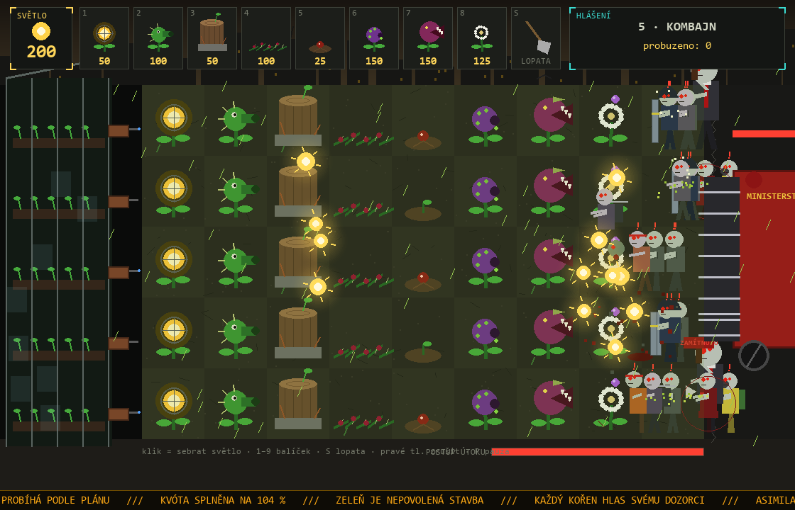

# Games

Hry naprogramované s pomocí Clauda.

| Hra | Popis | Spuštění |
|-----|-------|----------|
| [KVÓTA](KVOTA/) | Dystopická hra s padajícími bloky, solo i LAN souboj pro 2 hráče | Python 3.8+ → `KVOTA/HRAT.bat` |
| [KVÓTA 2.0](KVOTA2.0/KVOTA/) | Nová verze KVÓTY s víc LAN režimy. K Sabotáži přibyl **Závod směn** (Sprint na počet řádků, Časovka na čas, bez útoků) a **Ministerstvo** (jeden skládá, druhý jako úředník vybírá, který ze dvou bloků dostane, a razítkem zrychluje pád, cenzuruje hromadu nebo zamyká sloupec; v poločase se role prohodí). Hostitel volí podmínky zápasu (vítězná kola, startovní směna, cenzura, inflace, síla útoků, cíl sprintu, limity), po zápase odveta, kontrola stejné verze na obou PC a pravidla LAN režimů přímo v menu | Python 3.8+ → `KVOTA2.0/KVOTA/HRAT.bat` |
| [ZÁHON](ZAHON/) | Dystopická obrana skleníku: 5 úrovní s bossem, tajná puzzle úroveň, nekonečný režim, LAN souboj kytky vs. zombie ve 4 módech | Python 3.8+ → `ZAHON/HRAT.bat` |
| [Galaktická civilizace](GALAKTICKA-CIVILIZACE/) **v0.5 alfa** | Vesmírná budovatelská strategie ve skutečném měřítku: 107 798 reálných hvězd, černé díry, pulsary, Dysonovy sféry, antihmota a červí díry; úkoly, příručka, sandbox (WebGL). Ve vývoji. | Prohlížeč → `GALAKTICKA-CIVILIZACE/index.html` |
| [Neon Roj](Neon%20Roj%20LAN/) | Neonová arkádová střílečka proti roji: zbraně se vyvíjejí v silnější verze, vylepšení, lodě, sektory; solo nebo co-op 2–4 hráčů po síti | Prohlížeč → `index.html` (solo); co-op: Python 3.8+ → `Spustit co-op server.bat` |
| [APEX Kasino](apex-kasino/) | Budovatelská hra: z malé herny kasino s pěti hvězdami, patra, personál a režim CEO (C#, WinForms) | Windows → `apex-kasino/build.cmd`, pak `APEX Kasino.exe` |
| [Hra mrtvých králů](HRA-MRTVYCH-KRALU/) **v0.9 vývojová** (stabilní v0.5 je v historii) | Rozpracovaná 1.0: 5 map, AI soupeř ve 3 obtížnostech (Výcvik), frakce Přeživší, Korporace a Kult, režimy Přežití a Výuka, 10 hádanek; zatím neodladěné. Základ z v0.5: temná PvP strategie 1v1 po LAN ve stylu iluminované krypty: režimy Král (WASD, blok a odražení střel, výpad, válečný pokřik) a Stratég (5 rozkazů), balíček 8 karet, šachové figury, zombie z Mlhy, mlha války, zatmění, Relikvie, sporné bedny, výzkum a Doby, šach-mat, procedurální zvuky | Python 3.8+ → `HRA-MRTVYCH-KRALU/Spustit server.bat`, soupeř v prohlížeči |

## Jak stáhnout
Zelené tlačítko **Code → Download ZIP**, nebo sekce **Releases** vpravo.
